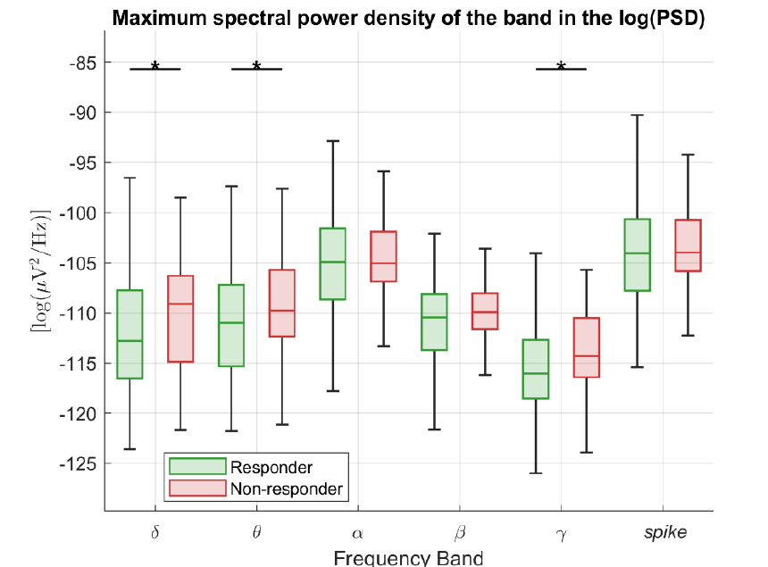
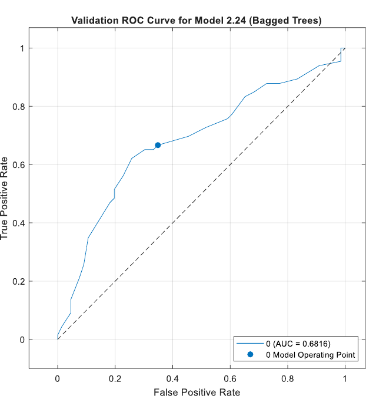

# Drug Response Prediction in Epilepsy from Pre-Treatment EEG Spectral Features

MATLAB code for the bachelor's thesis *Drug Response Prediction in Epilepsy: A Combined Approach of EEG Spectral Features and Machine Learning* (B.Sc. in Biomedical Engineering, Università Campus Bio-Medico di Roma, A.Y. 2024/25; supervisor: Dott.ssa Margherita A. G. Matarrese).

## Overview

Choosing an antiseizure medication (ASM) for a newly diagnosed patient is still largely trial and error, and about one third of patients remain drug-resistant. This project asks whether **pre-treatment resting-state EEG** carries information about the later response to the first ASM.

- **Cohort:** 231 drug-naïve adults with newly diagnosed focal epilepsy, retrospectively collected between 2018 and 2022 in a multi-centre Italian study (19-channel EEG, 10-20 system, 15 min of eyes-closed rest, at least 180 s of artefact-free signal).
- **Outcome:** seizure freedom one year after ASM start (responder, 165 patients, 71.4%) versus not (non-responder, 66 patients).
- **Approach:** power spectral density (PSD) features in six frequency bands, non-parametric statistics to find outcome-related features, and supervised classifiers to predict response.

<p align="center">
  
</p>

## Method

**Preprocessing** (MATLAB / Brainstorm, not included): 50 Hz notch and 1-70 Hz linear-phase FIR band-pass filter, resampling to 250 Hz, ICA removal of ocular and cardiac artefacts, interpolation of bad channels. The data were anonymised before analysis.

**Features.** The PSD is estimated with Welch's method and represented in three ways: raw, logarithmic (dB) and magnitude (square root). In six bands (δ 2-4 Hz, θ 5-7 Hz, α 8-12 Hz, β 15-29 Hz, γ 30-59 Hz and a broadband "spike" band 1-60 Hz) the scripts compute the mean, median and maximum power and the frequency of the maximum, plus alpha ratios (α power over δ, θ, β, γ power, and the same for peak frequencies). This gives **96 features per channel**, computed in non-normalised and normalised form and then averaged over the 19 channels into one vector per patient (231 x 96).

**Statistics.** Differences between bands are tested with Kruskal-Wallis and Bonferroni-corrected post-hoc comparisons; responders and non-responders are compared feature by feature with the Wilcoxon rank-sum test. Features are kept when p < 0.05 and |Cohen's d| > 0.2. The same analysis is repeated within the two drug classes, levetiracetam (LEV) and sodium-channel blockers (SCB).

**Classification.** Models are trained in the MATLAB Classification Learner app with 5-fold cross-validation and default hyperparameters (SVM, k-NN, trees, ensembles, discriminant analysis, naïve Bayes, logistic regression, neural networks). Feature sets range from all features to the statistically significant ones, a five-feature subset and the α/δ ratio alone. Because responders outnumber non-responders about 2.5 to 1, a balanced dataset is also built by randomly undersampling the responders. Since the clinically costly error is to predict a response for a patient who will not respond, specificity (correct identification of non-responders) and the false-positive rate are reported alongside accuracy.

## Results

- **Non-normalised log-PSD features are the most informative.** Normalisation reduces the between-group contrasts, and differences concentrate in the δ, θ and γ bands. Among the alpha ratios only the log-domain α/δ ratio reaches significance.
- **Classification is modest but above chance** (reported as mean ± SD over the 5 folds):

| Dataset | Model | Accuracy | Sensitivity | Specificity | ROC-AUC |
|---|---|---|---|---|---|
| Original (imbalanced), all features | RUSBoosted trees | 61.5 ± 5.6% | 61.8 ± 5.4% | 60.6 ± 12.8% | 0.64 ± 0.10 |
| Balanced, significant features | Bagged trees | 65.9 ± 5.6% | 65.2 ± 7.2% | 66.7 ± 12.0% | 0.68 |
| Balanced, significant features | Logistic regression (kernel) | 66.7 ± 6.2% | 71.2 ± 8.2% | 62.1 ± 12.3% | 0.63 |

- **Drug classes behave differently.** Outcome-related information is more abundant and sits in lower frequencies for LEV, and is sparser and higher in frequency for SCB.

<p align="center">
  
  
</p>

## Limitations

- **Feature selection is not nested in the cross-validation.** The "significant features" are chosen with statistical tests on the whole cohort, and the classifiers are then cross-validated on that subset, so the selection step has seen the test folds. The results for these feature sets are therefore likely to be optimistic (see Kapoor and Narayanan, 2023, on leakage). Models trained on all features do not have this problem; in the imbalanced setting they perform comparably to the reduced feature sets.
- **Multiple testing.** The feature-level Wilcoxon tests use p < 0.05 without correction across the many features tested; the effect-size threshold is the only additional filter.
- **Modest performance.** Models use default hyperparameters, accuracy stays around 60-67% and fold-to-fold variability is large, so the results show feasibility and not clinical readiness. Drug-specific models rest on small subgroups.
- **Single cohort.** There is no external validation set.

## Repository structure

```
.
├── matlab/
│   ├── dataset_ratios.m                   # PSD features + alpha ratios, patient-level tables
│   ├── data_sep.m                         # PSD-domain split, LEV/SCB split, balanced dataset
│   ├── statistical_analysis_2.m           # band-wise and group-wise statistics
│   ├── alpha_ratio_analysis.m             # alpha ratios, responders vs non-responders
│   ├── drug_stat_analysis_quadplots.m     # LEV vs SCB analysis and figures
│   ├── plot_visualization.m               # PSD transforms, counts of significant features
│   └── std_classifiers.m                  # fold-wise metrics of the exported classifiers
├── figures/
└── LICENSE
```

## Running the code

The EEG recordings and all patient-level tables are **not included**: they are clinical data from several hospitals. The scripts are provided to document the analysis. They need MATLAB with the Statistics and Machine Learning Toolbox; the PSDs come from a Brainstorm export.

1. Run `dataset_ratios.m` from the data folder (one sub-folder per patient with the Brainstorm PSD export, plus the outcome table). It writes `DB_TOT.csv`, `DB_TOT_norm.csv` and their patient-level averages `DB_TOT_avg.csv` and `DB_TOT_norm_avg.csv`.
2. Run `data_sep.m` to split the table by PSD representation (`<name>_psd.csv`, `<name>_log_psd.csv`, `<name>_mag_psd.csv`), by drug class and into the balanced dataset.
3. Run `statistical_analysis_2.m`, `alpha_ratio_analysis.m` and `drug_stat_analysis_quadplots.m` from the folder with `DB_TOT_avg.csv`.
4. Train the classifiers in the Classification Learner app, export the models and compute fold-wise metrics with `std_classifiers.m`.

## References

- Donoghue T., Dominguez J., Voytek B. (2020). *Electrophysiological frequency band ratio measures conflate periodic and aperiodic neural activity.* eNeuro, 7(6).
- Lee G. H. et al. (2025). *Predicting antiseizure medication response in newly diagnosed epilepsy using quantitative EEG and machine learning.* Seizure, 130, 59-67.
- Kapoor S., Narayanan A. (2023). *Leakage and the reproducibility crisis in machine-learning-based science.* Patterns, 4, 100804.

## License

Code released under the [MIT License](LICENSE). No clinical data are included.
